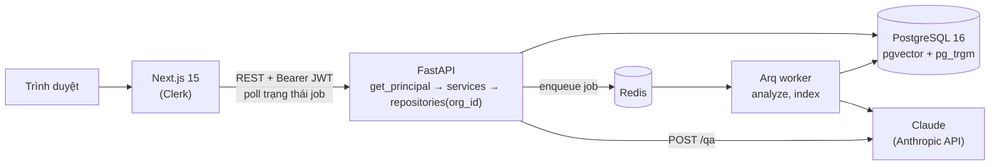

# MeetMind AI

[](https://github.com/nuroqzavitex/meetmind-ai/actions/workflows/ci.yml)

MeetMind AI biến transcript cuộc họp tiếng Việt thành biên bản có cấu trúc với đúng **trạng thái cuối**:
đề xuất A, cuối buổi chốt B thì B là quyết định, A bị thay thế. Mỗi mục có bằng chứng là câu nói gốc kèm
mốc thời gian. Một thành viên trong nhóm duyệt rồi phát hành. Các cuộc họp đã phát hành tạo thành kho tri
thức của nhóm để hỏi đáp có trích dẫn. Dữ liệu tách theo nhóm (Clerk Organizations).

Đặc tả thiết kế: [docs/superpowers/specs/2026-10-10-meetmind-mvp-design.md](docs/superpowers/specs/2026-10-10-meetmind-mvp-design.md)
(v3, thay [MVP_Spec.md](MVP_Spec.md)). Tài liệu chi tiết: [docs/backend.md](docs/backend.md),
[docs/frontend.md](docs/frontend.md), [evals/README.md](evals/README.md), [tests/e2e/README.md](tests/e2e/README.md).

## Tính năng

Theo danh sách "MVP xong khi" ở mục 0 của spec:

- **Đăng nhập và org.** Đăng nhập bằng Clerk, người dùng phải thuộc một organization. Dữ liệu của org này không lộ sang org khác (có bộ test cách ly).
- **Upload và duyệt.** Upload transcript (`.txt`, `.srt`, `.vtt`, `.docx`), màn hình duyệt hiển thị 7 loại mục: `decision`, `action_item`, `open_question`, `blocker`, `request`, `feedback`, `knowledge`. Mỗi mục có trích dẫn và mốc thời gian, bấm vào là cuộn tới câu gốc. Tab **Diễn biến chủ đề** cho thấy phương án nào bị thay thế lúc nào.
- **Kịch bản bẫy.** Các trường hợp A→B, chốt A rồi đổi B, quay lại A, mở lại, bác phương án đã chốt, chốt không rõ phương án và chờ cấp trên đều phải ra đúng trạng thái cuối.
- **Phát hành.** Duyệt xong thì phát hành, tải biên bản `.md` và `.json`. Sau phát hành có thể "Báo sai", mở lại mục, sửa rồi phát hành lại.
- **Hỏi đáp.** Hỏi trên các cuộc họp đã phát hành của org, câu trả lời có trích dẫn `[cuộc họp · hh:mm:ss · người nói]`. Câu hỏi ngoài dữ liệu nhận câu từ chối cố định.
- **Đánh giá.** `evals/` gồm 15 transcript (10 kịch bản bẫy, 5 transcript thực tế) và 18 câu hỏi QA, có ngưỡng ở mục 13.2 của spec.
- **CI.** Lint, type check, test, e2e, và eval khi prompt hoặc agent thay đổi.

## Kiến trúc



Phụ thuộc một chiều: `endpoints → services → repositories / ai`. Thư mục `backend/app/ai/` không biết gì về HTTP,
Clerk hay org, nên cùng một lõi chạy được từ API, worker và runner eval.

**Pipeline phân tích** (job `analyze`, LangGraph, `backend/app/ai/pipeline.py`):

```
normalize (parse) → extract (LLM, song song theo đoạn) → check_quotes ─┐
       ▲                                     đoạn có > 30% act sai trích dẫn │
       └──────────────────── chạy lại extract cho đoạn đó, tối đa 1 lần ────┘
→ topics (LLM) → state_machine (code) → arbitrate (LLM, chỉ khi có dấu hiệu mâu thuẫn)
→ build_items (code) → validate (code)
```

Worker lưu kết quả và cập nhật `jobs.step` / `progress` sau mỗi bước.

**Luồng hỏi đáp** (`POST /api/v1/qa`, `backend/app/services/qa.py`):

```
filter (LLM: dự án, ngày, người, loại mục, câu hỏi viết lại)
→ hybrid search: vector + trigram trên items và transcript_chunks, gộp RRF (k = 60, giữ 12)
→ supersession: đánh dấu ngữ cảnh "mới nhất" / "đã bị thay thế"
→ answer (LLM, chỉ dùng ngữ cảnh đánh số [n])
→ check_citations: bỏ [n] không tồn tại; không còn trích dẫn hợp lệ thì trả câu từ chối
```

## Quyết định thiết kế

- **Máy trạng thái tất định, không để LLM tự chốt.** LLM chỉ gán nhãn hành vi cho từng câu (đề xuất, phản đối, chốt, mở lại...). Code thuần (`ai/domain/state_machine.py`) suy ra trạng thái cuối của từng phương án nên kết quả lặp lại được và kiểm thử được bằng unit test.
- **Bằng chứng nguyên văn.** Mỗi act phải trỏ tới `utterance_id` và trích dẫn khớp đúng câu đó (rapidfuzz `partial_ratio ≥ 90`). Act sai trích dẫn bị loại, mục không còn bằng chứng bị bỏ. Hạn chót tương đối ("thứ Sáu tuần sau") do parser tiếng Việt tính, không do LLM tính.
- **Cách ly org ở repository.** Mọi hàm repository của bảng gốc bắt buộc nhận `org_id`, payload job Arq cũng mang `org_id`. Truy cập tài nguyên của org khác trả **404**, không phải 403, để không lộ việc tài nguyên tồn tại. Bộ test riêng: `tests/backend/api/test_org_isolation.py`.
- **Job bất đồng bộ.** Phân tích và lập chỉ mục chạy trong worker Arq. API trả `job_id` ngay, frontend poll `/jobs/{id}`. Lỗi phân tích hiện ra dạng dễ đọc và có thể chạy lại.
- **Tìm kiếm lai bằng RRF.** Bốn truy vấn (cosine pgvector và `pg_trgm` `word_similarity > 0.2`, mỗi loại trên mục và trên đoạn transcript) được gộp bằng Reciprocal Rank Fusion (k = 60), giữ 12 ngữ cảnh. Vector bắt được câu diễn đạt khác, trigram bắt được tên riêng và thuật ngữ. Mọi truy vấn lọc `org_id` và chỉ lấy cuộc họp `published`.
- **Supersession khi hỏi đáp.** Ngữ cảnh nhắc tới phương án đã bị thay thế được gắn nhãn "đã bị thay thế", quyết định cuối được thêm vào với nhãn "mới nhất". Ngữ cảnh sắp theo ngày họp để LLM trả lời theo trạng thái hiện hành.
- **Câu từ chối cố định.** Không có ngữ cảnh hoặc không còn trích dẫn hợp lệ sau kiểm tra thì trả đúng câu `Không đủ thông tin trong các cuộc họp đã phát hành.` với `citations = []`. Câu cố định giúp test và eval kiểm tra chính xác được.
- **FakeLLM và FixtureLLM.** Test dùng `FakeLLM` (phản hồi theo kịch bản trong bộ nhớ), e2e dùng `FixtureLLM` (`LLM_PROVIDER=fake`, đọc `tests/fixtures/llm/payment_v2/<agent>.json`). Vì vậy test và e2e không gọi Anthropic. Chỉ `evals/` gọi Claude thật.

## Chạy nhanh

**Yêu cầu:** Docker (kèm Docker Compose). Khi chạy không Docker hoặc chạy test: thêm [uv](https://docs.astral.sh/uv/) (tự cài Python 3.11 theo `backend/.python-version`) và Node 22 (≥ 22.22, yêu cầu của jsdom trong Vitest). Cần tài khoản Clerk (xem [Cấu hình Clerk](#cấu-hình-clerk)) và `ANTHROPIC_API_KEY`.

```bash
cp .env.example .env     # điền ANTHROPIC_API_KEY, CLERK_*, NEXT_PUBLIC_CLERK_PUBLISHABLE_KEY
make up                  # = docker compose up -d --build
# mở http://localhost:3000
```

`make up` chạy `db` (Postgres + pgvector), `redis`, `backend` (tự chạy `alembic upgrade head` rồi uvicorn, cổng 8000),
`worker` và `frontend` (cổng 3000). Kiểm tra backend: `curl localhost:8000/api/v1/health`. Tắt: `make down`.

Lần đầu phát hành hoặc hỏi đáp với `EMBEDDING_PROVIDER=local`, backend và worker tải model bge-m3 (khoảng 2 GB) vào volume
`hf-cache`. Muốn thử nhanh không tải model thì đặt `EMBEDDING_PROVIDER=hash` trong `.env` (chất lượng tìm kiếm thấp hơn).

**Chạy không Docker cho app** (chỉ Postgres và Redis chạy trong Docker):

```bash
cd backend && uv sync --extra embeddings && cd ..   # bỏ --extra embeddings nếu dùng EMBEDDING_PROVIDER=hash
cd frontend && npm install && cd ..
cp frontend/.env.example frontend/.env.local         # điền khoá Clerk cho frontend
# trong .env: đổi host db / redis thành localhost
make db         # chỉ bật db + redis
make migrate    # alembic upgrade head
make api        # terminal 1: uvicorn --reload, cổng 8000
make worker     # terminal 2: arq worker
make fe-dev     # terminal 3: next dev, cổng 3000
```

**Windows không có `make`:** dùng Git Bash có cài `make`, hoặc chạy lệnh gốc trong [Makefile](Makefile). Các bước chính trong PowerShell (mỗi lệnh chạy từ gốc repo; api, worker và frontend mỗi cái một terminal):

```powershell
Copy-Item .env.example .env
docker compose up -d --build                                   # make up
docker compose up -d db redis                                  # make db
cd backend; uv run alembic upgrade head                        # make migrate
cd backend; uv run uvicorn app.main:app --reload --port 8000   # make api
cd backend; uv run arq app.workers.main.WorkerSettings         # make worker
cd frontend; npm run dev                                       # make fe-dev
```

## Cấu hình Clerk

1. Tạo application trên [Clerk Dashboard](https://dashboard.clerk.com) (instance **development**).
2. Bật **Organizations**, tắt **Personal accounts**: người dùng bắt buộc thuộc một organization. Chưa có org đang hoạt động thì app chuyển tới `/select-org`.
3. **Sessions → Customize session token**, thêm claim:
   ```json
   { "name": "{{user.full_name}}" }
   ```
   Backend lấy tên người thao tác từ claim `name` (thiếu thì dùng `sub`) để ghi vào lịch sử mục. Org lấy từ claim `o.id` (session token v2) hoặc `org_id` (v1), có sẵn khi người dùng có org đang hoạt động.
4. Trong **API keys**, lấy:
   - Publishable key → `NEXT_PUBLIC_CLERK_PUBLISHABLE_KEY`
   - Secret key → `CLERK_SECRET_KEY`
   - Frontend API URL `https://<frontend-api>` → `CLERK_ISSUER=https://<frontend-api>` và `CLERK_JWKS_URL=https://<frontend-api>/.well-known/jwks.json`
5. `CLERK_AUTHORIZED_PARTIES=http://localhost:3000`: danh sách origin của frontend (phân tách bằng dấu phẩy). Backend từ chối token có `azp` ngoài danh sách này.
6. Cho e2e: bật đăng nhập bằng **Password**, tạo một user có mật khẩu (không bật MFA), thêm vào một organization, rồi điền `E2E_CLERK_USER_USERNAME` và `E2E_CLERK_USER_PASSWORD`. Chi tiết: [tests/e2e/README.md](tests/e2e/README.md).

Token thiếu hoặc sai trả 401, không có org đang hoạt động trả 403.

## Biến môi trường

Danh sách đầy đủ và giá trị mặc định nằm ở [.env.example](.env.example) (dùng cho Docker Compose và backend) và
[frontend/.env.example](frontend/.env.example) (sao chép thành `frontend/.env.local` khi chạy `npm run dev`).

| Biến | Ý nghĩa |
|---|---|
| `ANTHROPIC_API_KEY` | Khoá Anthropic cho pipeline, hỏi đáp và eval |
| `DATABASE_URL`, `REDIS_URL` | Postgres và Redis. Host `db` / `redis` trong Compose, `localhost` khi chạy local |
| `CLERK_JWKS_URL`, `CLERK_ISSUER`, `CLERK_AUTHORIZED_PARTIES` | Backend xác thực JWT của Clerk |
| `LLM_PROVIDER` | `anthropic` (mặc định) hoặc `fake` (chỉ dùng cho e2e, đọc fixture, không gọi Anthropic) |
| `LLM_MODEL_DEFAULT`, `LLM_MODEL_ARBITRATE` | Model cho các agent và cho arbitrate |
| `PROMPT_VERSION` | Phiên bản prompt (`ai/prompts/<agent>/vN.md`) |
| `EMBEDDING_PROVIDER`, `EMBEDDING_MODEL`, `EMBEDDING_DIM` | `local` (bge-m3, 1024 chiều) hoặc `hash` |
| `CORS_ORIGINS`, `MAX_UPLOAD_BYTES` | Origin được phép gọi API, kích thước file tối đa |
| `TEST_DATABASE_URL` | DB cho test và eval QA (tên phải kết thúc bằng `_test`) |
| `NEXT_PUBLIC_API_URL` | URL backend mà trình duyệt gọi, mặc định `http://localhost:8000` |
| `NEXT_PUBLIC_CLERK_PUBLISHABLE_KEY`, `CLERK_SECRET_KEY` | Khoá Clerk cho frontend |
| `E2E_CLERK_USER_USERNAME`, `E2E_CLERK_USER_PASSWORD` | User test cho Playwright |

`NEXT_PUBLIC_*` được nhúng lúc build: đổi giá trị thì phải build lại (`make up`).

## Test

Test không gọi LLM thật: backend dùng `FakeLLM`, JWT ký bằng khoá test và JWKS giả; frontend mock Clerk và API;
e2e dùng `LLM_PROVIDER=fake` và `EMBEDDING_PROVIDER=hash`.

Chuẩn bị: `cd backend && uv sync`, `cd frontend && npm install`; riêng e2e cần thêm db + redis chạy và đã migrate,
truy cập qua `localhost` (`make db && make migrate`). Nếu volume `pgdata` có từ trước khi thêm script init (thiếu DB
`meeting_test`): `docker compose exec db psql -U app -d meeting -c "CREATE DATABASE meeting_test"`.

```bash
docker compose up -d db   # test DB cần Postgres (DB meeting_test do docker/postgres-init tạo)
make test                 # backend pytest (bắt buộc có Postgres) rồi frontend: eslint + tsc + vitest
make lint                 # ruff + mypy cho backend
make types                # sinh lại frontend/src/types/api.ts từ OpenAPI của backend
make e2e                  # Playwright: đăng nhập → upload → duyệt → phát hành → tải .md → hỏi đáp
```

Lần chạy gần nhất: backend 434 test, frontend 114 test. E2E cần user test Clerk và chạy
`cd frontend && npx playwright install chromium` lần đầu, xem [tests/e2e/README.md](tests/e2e/README.md).
CI ([.github/workflows/ci.yml](.github/workflows/ci.yml)) chạy lint, type, test, build, kiểm tra type API
không lệch; e2e tự bỏ qua khi chưa cấu hình secret Clerk.

## Đánh giá (evals)

`evals/` gọi Claude thật trên 15 transcript (10 kịch bản bẫy, 5 transcript thực tế) và 18 câu hỏi QA, rồi so với golden.
Runner thoát với mã 1 nếu có chỉ số dưới ngưỡng. Ngưỡng lấy từ [evals/config.yaml](evals/config.yaml).

| Chỉ số | Ngưỡng | Kết quả |
|---|---|---|
| `precision` | ≥ 0.85 | chưa chạy (`make eval`) |
| `recall` | ≥ 0.75 | chưa chạy (`make eval`) |
| `final_decision_accuracy` | ≥ 0.90 | chưa chạy (`make eval`) |
| `owner_due_accuracy` | ≥ 0.85 | chưa chạy (`make eval`) |
| `evidence_faithfulness` | ≥ 1.00 | chưa chạy (`make eval`) |
| `trap_accuracy` | ≥ 1.00 | chưa chạy (`make eval`) |
| `qa_citation_accuracy` | ≥ 0.85 | chưa chạy (`make eval` hoặc `make eval-qa`) |
| `qa_latest_state_accuracy` | ≥ 1.00 | chưa chạy (`make eval` hoặc `make eval-qa`) |
| `qa_refusal_accuracy` | ≥ 1.00 | chưa chạy (`make eval` hoặc `make eval-qa`) |

Chạy: cần `ANTHROPIC_API_KEY`; eval QA cần thêm Postgres (`docker compose up -d db`, `TEST_DATABASE_URL`) và
`uv sync --extra embeddings` trong `backend/` khi dùng embedder `local`. `make eval` chạy cả hai runner, `make eval-qa`
chỉ chạy QA. Báo cáo ghi vào `evals/reports/`.

Transcript và golden được soạn nháp bằng Claude. **Golden cần người xem lại và xác nhận** trước khi dùng làm chuẩn
(spec 13.2). Workflow [eval.yml](.github/workflows/eval.yml) chạy eval khi PR đụng tới `backend/app/ai/prompts/`,
`backend/app/ai/agents/` hoặc `evals/`, và tự bỏ qua khi chưa có secret `ANTHROPIC_API_KEY`.
Chi tiết dataset và quy ước gán nhãn: [evals/README.md](evals/README.md).

## Cấu trúc thư mục

```
backend/
  app/
    ai/            lõi AI: agents/, domain/ (máy trạng thái, hạn chót), llm/, prompts/, retrieval/, pipeline.py
    api/           endpoint FastAPI (/api/v1)
    core/          cấu hình, xác thực Clerk, lỗi
    models/ db/    SQLAlchemy
    repositories/  truy cập dữ liệu, luôn lọc org_id
    services/      nghiệp vụ: phân tích, duyệt, phát hành, hỏi đáp
    workers/       Arq worker (analyze, index)
  alembic/         migration
frontend/
  src/app/         route Next.js (App Router)
  src/features/    meetings, review, topics, minutes, qa
  tests/           Vitest
tests/
  backend/         unit, integration, db, api (gồm test_org_isolation.py)
  e2e/             Playwright
  fixtures/        transcript và phản hồi LLM cho FixtureLLM
evals/             datasets/, golden/, metrics/, runners/, config.yaml
docker/            script khởi tạo Postgres (DB test)
docs/              tài liệu backend, frontend, spec
```

## Giới hạn và hướng phát triển

- **Không có chuyển giọng nói.** Input luôn là transcript có sẵn; STT (WhisperX + pyannote) nằm ngoài phạm vi đợt này.
- **Model embedding nặng.** bge-m3 tải khoảng 2 GB lần đầu và API, worker mỗi bên giữ một bản trong RAM. Image Docker cài torch bản CPU.
- **Hỏi đáp một lượt, không streaming.** Không nhớ hội thoại, câu trả lời trả về một lần.
- **Chuỗi thay thế chỉ trong một cuộc họp.** Nối quyết định xuyên cuộc họp và phát hiện mâu thuẫn với quyết định cũ là P2.
- **Chưa phân quyền theo vai trò.** Mọi thành viên org đều duyệt và phát hành được.
- **Eval chưa có kết quả.** Bảng trên chưa có số; golden cần người xác nhận.
- **Chưa tích hợp** Jira, Notion, Slack, bot họp thời gian thực (P2).
